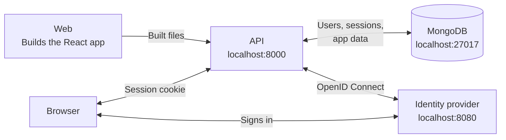

<h1></h1>

**A template for internal web apps whose users sign in with their company
account.** Sign-in, sessions, error handling, logging and tests are already
built, with a small example app to replace with your own.

Built with FastAPI and MongoDB on the back, React and TanStack Query on the
front, Docker Compose for development, and one image to deploy.

## What you get

- **Company sign-in** through OpenID Connect, set by environment variables.
  Nothing is written against one provider.
- **Sign-out that reaches the provider**, and sessions the provider can end
  remotely if it supports that.
- **Security defaults:** CSRF protection on API calls, a strict Content
  Security Policy, and HSTS over HTTPS.
- **A typed client** generated from the API, so a backend change shows up as
  a compiler error in the frontend.
- **Consistent errors** the interface can show as they are, and one JSON log
  line per request.
- **Startup that fails fast** on a missing setting or an unreachable
  database or provider.
- **Tests** against a real database and a fake identity provider, run in CI
  with lint, type checks and the image build.
- **A fast loop:** one command starts everything, and a saved file is picked
  up in seconds.

## Required tools

- **[Docker](https://docs.docker.com/get-started/get-docker/)** runs
  containers. Docker Compose starts the whole development stack: the app,
  its database and a local identity provider. The stack uses the host
  network so the browser, the app and the provider all reach each other at
  the same `localhost` URLs, which sign-in depends on. Ports 8000, 8080 and
  27017 must be free, and Docker must have
  [host networking enabled](https://docs.docker.com/engine/network/drivers/host/).
  On Docker Desktop, turn on **Settings → Resources → Network → Enable host
  networking**.
- **[uv](https://docs.astral.sh/uv/getting-started/installation/)** manages
  Python and its packages. It runs the API's tests, lint and scripts, and
  downloads the right Python if you don't have it.
- **[just](https://just.systems/man/en/packages.html)** is a command runner.
  Every development command is defined in the [justfile](justfile), and
  `just` alone lists and describes them. With uv installed,
  `uv tool install rust-just` installs it.
- **[pnpm](https://pnpm.io/installation)** manages Node packages. It runs
  the frontend's tests and lint, and downloads the right Node. Starting the
  app doesn't need it.

## Quickstart

```sh
git clone https://github.com/kareemalzahal03/internal-app-template.git
cd internal-app-template
just up      # build and start the stack
just seed    # optional: add demo data
```

Open http://localhost:8000 and sign in with any username (for example
`admin`) and any password. The API's docs are at
http://localhost:8000/api/docs.

Run `just down` to stop the stack.

## Development

Run `just install` to install dependencies for the editor, tests and lint.
Run `just test` to run all tests and `just lint` to run the lint check.

Save a file in a service's source folder and the running app picks it up.
After any other change, such as a dependency, run `just up` again.

The dev stack is defined in `compose.yml`, and its images in the
`Dockerfile`:



- **Browser** runs the React app and talks only to the API, except to sign
  in at the identity provider. It holds a session cookie that scripts can't
  read, never a token.
- **API** (`api`, in [services/api/](services/api/)) is the FastAPI backend,
  and serves the built React app too. It is a *backend for frontend* (BFF):
  it signs people in with the provider and keeps their sessions on the
  server. `app/core/` is the template, and `app/domain/` the example.
- **Web** (`web`, in [services/web/](services/web/)) builds the React app
  and rebuilds it when a file is saved. The API serves the result,
  so it has no port. `src/domain/` is the example.
- **MongoDB** (`mongo`) stores the users, their sessions and the app's data.
  A deployed app uses a MongoDB of your own.
- **Identity provider** (`dev-idp`, in [services/dev-idp/](services/dev-idp/))
  stands in for your company's provider, and accepts any username and
  password. It is never deployed.

## Documentation

| To… | Read |
|---|---|
| Check it fits, make a copy your own, extend it, deploy it | [docs/adopting.md](docs/adopting.md) |
| See what is left out or missing, and why | [docs/decisions.md](docs/decisions.md) |
| Understand the tools and pinned versions | [docs/toolchain.md](docs/toolchain.md) |
| Understand sign-in and sessions | [services/api/AUTH.md](services/api/AUTH.md) |
| Work on the API, or its tests | [services/api/README.md](services/api/README.md), [services/api/TESTING.md](services/api/TESTING.md) |
| Work on the frontend | [services/web/README.md](services/web/README.md) |
| Know the local identity provider | [services/dev-idp/README.md](services/dev-idp/README.md) |
| Contribute, or work with a coding agent | [.github/CONTRIBUTING.md](.github/CONTRIBUTING.md), [AGENTS.md](AGENTS.md) |
| Report a security flaw | [.github/SECURITY.md](.github/SECURITY.md) |
