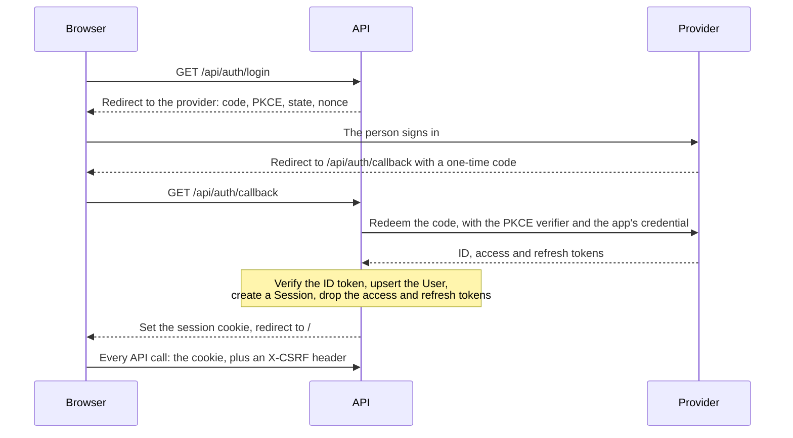

# Auth

**The identity provider owns credentials. This app owns the session.**

This file is the design of sign-in: what the specs require, and what this
app chose where they leave a choice. How the code does each part is in its
comments. The frontend's half is in
[services/web/README.md](../web/README.md), and the dev provider in
[services/dev-idp/README.md](../dev-idp/README.md).

## What this is

The API is the backend for frontend (BFF) of
[RFC 10017 §6.1](https://www.rfc-editor.org/rfc/rfc10017.html#section-6.1),
OAuth 2.0 for Browser-Based Applications. The API is the OAuth client, not
the browser. It runs sign-in on the server and gives the browser an opaque
session cookie, so no token ever reaches the browser.

In the pattern as drawn, the BFF keeps the user's access token and forwards
the SPA's calls to a separate API. Here the API the SPA calls is the BFF
itself, which §6.1.2.5 allows. So there is nothing to forward and no access
token to keep: the session stands in for it. Sign-in uses OpenID Connect
(§6.1.2.4), and every provider URL and key comes from its discovery
document.

The authorization request follows
[OIDC Core §3.1.2.1](https://openid.net/specs/openid-connect-core-1_0.html#AuthRequest)
with PKCE ([RFC 7636](https://www.rfc-editor.org/rfc/rfc7636)), and the ID
token is checked as in
[§3.1.3.7](https://openid.net/specs/openid-connect-core-1_0.html#IDTokenValidation).
Login, callback and logout are full-page navigations, not `fetch` calls,
because the browser has to visit the provider itself. They answer with
redirects, including on failure. `/me` is the only auth route the SPA
calls, and the only one in the API contract. The others are left out of it
(`include_in_schema=False`), so the generated client has no function to
call them with. So are the routes only the provider calls: the logouts and
`/jwks`.

## RFC 10017 §6.1, requirement by requirement

The code that meets each one cites its section, so a search for the
section finds it.

| § | Requirement | How it is met |
|---|---|---|
| 6.1.3.1 | MUST be a confidential client | `private_key_jwt`, or `client_secret_basic`, at the token endpoint |
| 6.1.3.1 | MUST use the authorization code grant ([RFC 9700 §2.1.1](https://www.rfc-editor.org/rfc/rfc9700.html#section-2.1.1)) | The code grant, with PKCE S256 |
| 6.1.3.2 | MUST set `Secure` and `HttpOnly` | On the session cookie |
| 6.1.3.2 | SHOULD set `SameSite=Strict`, `Path=/`, no `Domain`, and a prefix showing it was set over HTTP | All of them, with the prefix `__Host-Http-` |
| 6.1.3.2 | SHOULD encrypt the cookie's contents | Not needed: the cookie holds a random id, and the session data stays in Mongo |
| 6.1.3.3 | MUST defend against CSRF | `SameSite=Strict`, plus the header below |
| 6.1.3.3.2 | SHOULD require a custom request header | `X-CSRF` on every API call |
| 6.1.3.6 | MUST allowlist outbound destinations | Nothing is forwarded, so nothing to allow |

`SameSite=Strict` alone is not enough for internal apps. A request from a
sibling app (`b.company.com` calling `a.company.com`) is same-site, so the
browser sends the cookie (§6.1.3.3.1). The header closes that gap. A form
cannot add a header, and a `fetch` from another origin can only add one
after a CORS preflight, which this API never answers. So never add CORS
that allows credentials.

The navigations cannot carry the header, and none of them returns the
user's data. Their side effects have other guards: the callback has `state`
and PKCE, front-channel logout matches a session id, and logout is covered
under "Signing out".

## Decisions the specs leave to us

### Nothing is written against the provider

Three settings name the provider: `OIDC_ISSUER`, `OIDC_CLIENT_ID`, and one
credential, `OIDC_CLIENT_KEY` or `OIDC_CLIENT_SECRET`. Everything else comes
from discovery, so moving from the dev provider to Entra ID, Okta or Cognito
changes only those three.

What the provider is told about this app is defined once, in the code.
`just client-metadata https://…` prints it for a real provider, and
`just generate-dev-idp-client` writes it as the dev provider's client, so the
two cannot disagree.

### How the app proves who it is

The app is a confidential client: when it redeems a code, it proves to the
provider that it is this app. Which credential it is given decides how.

| | `OIDC_CLIENT_KEY` → `private_key_jwt` | `OIDC_CLIENT_SECRET` → `client_secret_basic` |
|---|---|---|
| What the app sends | A JWT it signs for that one request ([RFC 7523 §3](https://www.rfc-editor.org/rfc/rfc7523#section-3)) | The secret itself |
| What the provider stores | The public key only | The secret |
| If the provider's copy leaks | Nobody can act as the app | Anyone can act as the app |
| Who supports it | The dev provider, Okta, Keycloak, Ping | Every provider, and the only choice on Cognito |

[RFC 9700 §2.5](https://www.rfc-editor.org/rfc/rfc9700.html#section-2.5)
recommends the key, so the dev stack uses one. Setting both credentials, or
neither, fails startup. So does a provider whose discovery document does
not list the chosen method; a document with no list is read as
`client_secret_basic` only
([OIDC Discovery §3](https://openid.net/specs/openid-connect-discovery-1_0.html#ProviderMetadata)).

The key is a private RSA JWK on one line; `just client-key` makes one. The
app serves its public half at `GET /api/auth/jwks`, registered as
`jwks_uri`, so changing the key needs no new registration
([OIDC Registration §2](https://openid.net/specs/openid-connect-registration-1_0.html#ClientMetadata)).
A provider that cannot reach the app can be given the printed public key as
`jwks` instead, never both. Entra ID takes neither: it registers an
uploaded certificate. The JWT's audience is the provider's issuer, as
[draft-ietf-oauth-rfc7523bis](https://datatracker.ietf.org/doc/draft-ietf-oauth-rfc7523bis/)
requires.

Cognito needs one exception, at sign-out: its `/logout` ignores the
standard `post_logout_redirect_uri` and wants its own `logout_uri`. The
sign-out redirect sends both, with the same URL; providers that follow the
spec ignore the extra one.

### The provider is checked at startup

Startup loads the discovery document and checks that its issuer is exactly
`OIDC_ISSUER` (OIDC Discovery §4.3). An unreachable provider, an error or
the wrong issuer fails startup, so a bad setting fails the deploy instead of
every sign-in. The cost: while the provider is down, a new task cannot
start. Running tasks keep serving, and signed-in people are unaffected,
because sessions are local.

### App URLs come from `APP_URL`, never the request

Every URL the app sends, to the provider or the browser, is built from
`APP_URL`, and `ClientMetadata` registers the same values. Behind a proxy,
the request the API sees is not the one the browser sent: a CDN may replace
the `Host`, and a load balancer that ends HTTPS makes the scheme `http`. A
callback built from the request would not match the registered one, and
the provider would refuse every sign-in. The `Host` header is also chosen
by whoever sends the request.

### Users are keyed on `sub`

[OIDC Core §5.7](https://openid.net/specs/openid-connect-core-1_0.html#ClaimStability)
makes `sub` the stable identifier; an email can change or be reassigned.
Strictly, the key is `iss` plus `sub`, and with one provider `sub` is
enough (`docs/decisions.md`, "Current gaps"). `User` mirrors the provider's
claims and decides nothing: it has no password and no `is_active`, because
whether someone may sign in is the provider's decision.

### Server-side sessions and two clocks

The cookie holds 32 random bytes, never the document's ObjectId, which is
guessable. Deleting the `Session` document ends the session everywhere at
once, which a self-contained token could not do.

A session ends on whichever clock runs out first: `SESSION_IDLE` since the
last request (30 minutes), or `SESSION_MAX` since sign-in (10 hours). These
are Keycloak's defaults. They are constants in the code, not settings,
because they are policy; set them to your provider's values. They mirror
the provider's policy rather than observe it: a sign-out elsewhere is only
seen here if the provider sends back-channel logout.

### Two cookies

| Cookie | Lives | Carries | SameSite |
|---|---|---|---|
| `__Host-Http-oauth-state` | 5 minutes | `state`, `nonce` and the PKCE verifier for one sign-in | `Lax` |
| `__Host-Http-session` | Until `SESSION_MAX` | The session's random token | `Strict` |

The state cookie is `Lax` because it must arrive on the redirect back from
the provider, which is cross-site. The session cookie is `Strict`, because
everything that reads it is a same-site `fetch`. Switch it to `Lax` if a
guarded page must open from a link elsewhere, such as an email.

The `__Host-Http-` prefix (RFC 10017 §6.1.3.2, Layered Cookies §4.1.3.4)
makes the browser refuse the cookie unless it is `Secure`, `HttpOnly`, on
`Path=/` and with no `Domain`. So no other host, and no script on this
page, can set it. Browsers that only know `__Host-` still enforce all of
that but `HttpOnly`.

The names are the same in every app built from this template. Browsers do
not separate cookies by port, so two apps on one laptop's `localhost`
replace each other's session cookie; the other app then asks you to sign in
again.

### The tokens are discarded; the ID token is kept

The access and refresh tokens are checked at the callback and dropped. This
API is the only thing the app calls, and it trusts its own session, so no
token has anything to open. Keeping them would mean encrypting them,
refreshing them, and handling two refreshes at once. To call other
services, see `services/api/README.md`, "Calling other services".

The ID token is kept only for sign-out, as `id_token_hint`. Without it, the
provider cannot tell a real sign-out from a link someone was tricked into
following, so it asks the user to confirm.

The cost: the provider is not asked again during a session. Disabling
someone at the provider stops their next sign-in, not the session they
have, so `SESSION_MAX` is the longest they keep access, unless back-channel
logout ends it sooner. Deleting their `sessions` documents ends it at once.

### Sign-in takes no destination

The callback always redirects to `/`. A `next` parameter would be the only
value a caller could make the app redirect to, and nothing needs one. If it
comes back, it needs a guard that parses the URL as a browser does:
`//evil.example`, `/\evil.example` and a path with a tab in it all leave
the site. Starlette and FastAPI have no such guard.

### Enforced on routers, not routes

The domain routers carry `dependencies=AUTHENTICATED`, so a new route is
protected without anyone remembering to. `/api/health` stays unguarded, so
the load balancer's probe still reaches it; that is why the guard is on the
domain routers, not the `/api` router above them.

### Signing out: here first, then at the provider

`/logout` deletes the session and clears the cookie first, whatever
happens next, because that half protects this app's data and must not
depend on the provider. Then it sends the browser to the provider's
`end_session_endpoint`. Without that step, signing in again would be let
straight through by the provider's session, and the button would seem to
do nothing.

A link on a sibling app could sign someone out (logout CSRF). OWASP rates
this low, and a hostile page can send the user to the provider's public
logout URL anyway, so it is accepted.

Signing out at the provider signs the user out of every app that uses it.
To end only this app's session, have sign-out redirect to the login page
without calling the provider.

### Logout from the provider is best effort

The provider can end sessions two ways, both optional:

- **Back-channel** (`POST /api/auth/backchannel-logout`): the provider's
  server posts a signed logout token, validated step by step as in
  [Back-Channel Logout §2.6](https://openid.net/specs/openid-connect-backchannel-1_0.html#Validation).
  The signature is the authentication; there is no cookie.
- **Front-channel** (`GET /api/auth/frontchannel-logout`): the provider's
  logout page loads this URL in a hidden iframe. Nothing in it is signed, so
  it only ends sessions it can match.

Sessions are matched by the provider's session id (`sid`), so ending one
provider session leaves the person's other browsers signed in. No code
assumes either route is ever called; the two clocks are what guarantee a
session ends.
